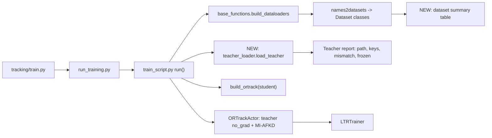

# Chuẩn bị training distill: BiRTrack (student) ← ORTrack-DeiT (teacher)

## Mục tiêu
1. Teacher weights **linh hoạt** (trỏ thẳng vào `.zip` hoặc `.pth.tar`), có **báo cáo xác nhận** tồn tại + load đúng.
2. Dataset roots **linh hoạt**, trỏ về `/mnt/DATA/tuld3/Datasets/tracking/...`.
3. Khi build dataloader, **in bảng tổng kết số sequence** từng dataset (+ cảnh báo nếu lệch số kỳ vọng).
4. Chạy distill: student = `deit_tiny_student_birtrack_uav` (DeiT-6 blocks + Rep-BLGR + MI-AFKD), teacher = ORTrack-DeiT (12 blocks) từ zip của bạn.

---

## Kết quả audit hiện trạng ("đã sẵn sàng chưa?") → **CHƯA**

| # | Hạng mục | Trạng thái | Chi tiết |
|---|---|---|---|
| A | Python env | ❌ **Blocker** | `base` không có torch; `reid_env` có torch 2.x + timm 1.0.30 nhưng thiếu `easydict, cv2, jpeg4py, lmdb, scipy, pandas, tensorboardX, pycocotools, visdom, wandb`. |
| B | Teacher zip | ✅ tồn tại | `deit_tiny_patch16_224/ORTrack_ep0300.pth.tar` (107 MB) bên trong zip. |
| C | Config student trỏ teacher | ❌ | `TEACHER_CKPT: teacher_model/deit_tiny_teacher_saorr_uav/...` → **file không tồn tại** → code fallback sang `teacher_model/deit_tiny_patch16_224/...` → cũng không tồn tại → crash. |
| D | Load teacher | ⚠️ **nguy hiểm** | [train_script.py:L82](file:///home/ubuntu22/tuld3/tu_workspace/track_uav/BirTrack/lib/train/train_script.py#L82) dùng `strict=False` và **bỏ qua** missing/unexpected keys → nếu key lệch, teacher sẽ là backbone ImageNet + head random mà không ai biết. |
| E | Teacher mode | ⚠️ bug | Teacher không bao giờ được `.eval()` (`BaseActor.train()` chỉ đổi mode của `self.net`). Head CENTER có BatchNorm → teacher chạy BN ở train-mode và **cập nhật running stats**. Teacher cũng không `requires_grad_(False)`. |
| F | `cfg_teacher = cfg` | ⚠️ | Alias cùng object, mutate rồi restore — dễ vỡ khi thêm field. Thay bằng `copy.deepcopy`. |
| G | DDP | ⚠️ | Wrap teacher (không có param cần grad) bằng DDP sẽ lỗi khi multi-GPU. Single-GPU không ảnh hưởng. |
| H | Dataset paths | ❌ | [local.py](file:///home/ubuntu22/tuld3/tu_workspace/track_uav/BirTrack/lib/train/admin/local.py) mặc định `/workspace/data/Raw_datasets` / `./data` → không khớp server. (`got-10k` thực tế tên là **`got10k`**.) |
| I | COCO17 | ❌ | Loader cần `root/images/train2017/` + `root/annotations/instances_train2017.json`; thực tế là `Coco2017/train2017/train2017/` và `Coco2017/annotations_trainval2017/annotations/`. |
| J | UAV123 | ❌ bug | Thư mục có 91 video folders nhưng 123 sequence annotation. Loader hiện tại: (1) với video bị chia đoạn (`bird1_1/2/3`) chỉ đọc `_1` → **mất phần lớn annotation**; (2) **off-by-one**: frame_id=k (k≥1) thử `00000k.jpg` trước → lấy nhầm frame k thay vì k+1 → bbox lệch 1 frame. |
| K | UAV-Anti-UAV, ANTI300 RGB/IR, GOT10k | ✅ cấu trúc khớp | UAV-Anti-UAV: train 1400 / test 420 seq; ANTI300: train 160 / valid 67 (cả RGB lẫn IR); GOT10k train 9335 seq (vottrain 7086, votval 1249). |
| L | ImageNet init | ✅ | `~/.cache/torch/hub/checkpoints/deit_tiny_patch16_224-a1311bcf.pth` có sẵn (student 6-block cũng dùng file này). |
| M | GPU | ⚠️ | RTX 5000 Ada 32 GB, **đang có process khác chiếm ~15 GB** (pid 518350). Batch 32 với teacher+student (student forward 2 lần do ORR) cần đo thực tế. |
| N | `train_script_distill.py` | ℹ️ | Là code STARK cũ, không chạy được. Distill của repo được bật bằng `MODEL.IS_DISTILL: True` trong yaml, **không** phải cờ `--distill 1`. |

---

## Open Questions

> [!IMPORTANT]
> **Q1 – Python env:** (a) *(Đề xuất)* tạo env mới `birtrack` (python 3.10, torch build cho CUDA của máy), tách biệt khỏi `reid_env`; (b) pip install bổ sung vào `reid_env` (nhanh hơn nhưng có thể làm hỏng env ReID của bạn, ví dụ khi pin `numpy`/`opencv`).

> [!IMPORTANT]
> **Q2 – UAV123 dùng để train?** Nếu train trên toàn bộ 123 seq thì **không thể** báo cáo benchmark UAV123 công bằng sau này. Bạn xác nhận vẫn đưa UAV123 vào train?

> [!WARNING]
> **Q3 – Val dùng `UAV_Anti_UAV_val` = split `test`.** Chỉ dùng để theo dõi loss (không chọn checkpoint theo nó) thì OK; nếu sau này test trên chính split này thì nên tách. Giữ nguyên?

> [!NOTE]
> **Q4 – Tên experiment:** tôi đề xuất tạo yaml mới `deit_tiny_student_birtrack_uav_ortrackT.yaml` (giữ nguyên yaml cũ dành cho teacher SA-ORR sau này), hay sửa thẳng `deit_tiny_student_birtrack_uav.yaml`?

---

## Kiến trúc luồng (để định vị thay đổi)



Thứ tự đọc đề xuất: `train_script.py` → `actors/ortrack.py` (forward_pass, compute_losses) → `losses/mi_afkd.py` → `base_functions.py` → các file trong `lib/train/dataset/`.

---

## Trade-offs

### 1. Cách cung cấp teacher weights

| Phương án | Tốc độ | Disk | Linh hoạt | Rủi ro |
|---|---|---|---|---|
| (a) Giải nén zip 1 lần vào `teacher_model/` rồi trỏ path cố định | nhanh nhất | +107 MB | thấp (path cứng) | quên giải nén khi đổi teacher |
| (b) **Đọc thẳng member `.pth.tar` trong zip vào RAM** (`zipfile` + `io.BytesIO`) | ~1 s thêm/lần chạy | 0 | cao | zip nhiều member → cần chọn |
| (c) Hỗ trợ cả hai (`.zip` hoặc `.pth/.tar`) | – | – | cao nhất | code thêm ~15 dòng |

**Chọn (c)**: chỉ chạy 1 lần lúc khởi động nên chi phí đọc zip không đáng kể; bạn có thể đổi teacher chỉ bằng 1 đường dẫn. Xem lại nếu checkpoint > vài GB (khi đó đọc zip vào RAM tốn gấp đôi bộ nhớ tạm thời → nên giải nén).

**Thứ tự ưu tiên đường dẫn:** CLI `--teacher_ckpt` > env `TEACHER_CKPT` > yaml `MODEL.TEACHER_CKPT`. Path tương đối được resolve theo **repo root** (không theo CWD). **Bỏ fallback im lặng**: không tìm thấy → raise lỗi rõ ràng.

### 2. Chính sách load teacher

| Phương án | Ưu | Nhược |
|---|---|---|
| `strict=True` | sai là crash ngay | teacher checkpoint của ORTrack có thể chứa key phụ vô hại → crash không cần thiết |
| `strict=False` im lặng (hiện tại) | không bao giờ crash | **có thể train với teacher random mà không biết** |
| **`strict=False` + báo cáo + ngưỡng** | thấy rõ mọi key lệch; raise nếu thiếu key thuộc `backbone.*`/`box_head.*` hoặc lệch shape | thêm vài chục dòng |

**Chọn phương án 3.** Ngoài ra kiểm chứng sau load: so sánh lại vài tensor trong `net.state_dict()` với checkpoint (`torch.equal`) để chắc đã copy thật.

### 3. Dataset roots linh hoạt

| Phương án | Ưu | Nhược |
|---|---|---|
| (a) Chỉ sửa default trong `local.py` | đơn giản | đổi máy phải sửa code |
| (b) Env vars (đã có sẵn cơ chế) + default mới `DATA_ROOT=/mnt/DATA/tuld3/Datasets/tracking` | không sửa code khi đổi máy | path không nằm trong log experiment |
| (c) Thêm `DATA.ROOTS` vào yaml | mỗi experiment tự mô tả | phải thêm key vào `config.py` |

**Chọn (b) + in path thực tế ra bảng summary** (nên log vẫn ghi lại path đã dùng). Không thêm (c) để tránh thêm 1 lớp ưu tiên nữa. Xem lại nếu bạn cần chạy song song nhiều experiment với dataset khác nhau trên cùng máy.

### 4. Đếm frame trong summary

Đếm số sequence là O(1) (đã có `sequence_list`). Đếm frame = đọc toàn bộ annotation, O(S) file I/O (S ≈ 9.7k seq) → vài chục giây. **Chọn:** train log chỉ in **#sequence**; preflight script có cờ `--count_frames` để đếm thêm frames + visible frames.

---

## Proposed Changes

### Component 1 — Teacher loader

#### [NEW] [teacher_loader.py](file:///home/ubuntu22/tuld3/tu_workspace/track_uav/BirTrack/lib/train/utils/teacher_loader.py)
```python
def resolve_teacher_path(cli_path, cfg) -> str          # CLI > env > yaml, resolve theo repo root
def read_checkpoint(path) -> dict                       # .zip (đọc member *.pth.tar trong RAM) hoặc .pth/.tar
def load_teacher_weights(net, ckpt, strict_prefixes=("backbone.", "box_head.")) -> dict
    # load_state_dict(strict=False) -> missing/unexpected/shape-mismatch
    # raise nếu missing key thuộc strict_prefixes hoặc có shape mismatch
    # verify: torch.equal trên N tensor mẫu
def freeze_teacher(net)                                 # eval() + requires_grad_(False)
def print_teacher_report(report)                        # path, size, md5 ngắn, epoch, #loaded/#total, missing, unexpected
```

#### [MODIFY] [train_script.py](file:///home/ubuntu22/tuld3/tu_workspace/track_uav/BirTrack/lib/train/train_script.py)
```diff
-            cfg_teacher = cfg
+            cfg_teacher = copy.deepcopy(cfg)          # không alias, không cần restore
             ...
-            custom_ckpt = getattr(cfg.MODEL, "TEACHER_CKPT", "")
-            if custom_ckpt and os.path.exists(custom_ckpt): ...
-            else: ... fallback ...
-            checkpoint = torch.load(teacher_ckpt_path, map_location="cpu")
-            net_teacher.load_state_dict(checkpoint["net"], strict=False)
+            path = resolve_teacher_path(settings.teacher_ckpt, cfg)
+            report = load_teacher_weights(net_teacher, read_checkpoint(path))
+            freeze_teacher(net_teacher); print_teacher_report(report)
             net_teacher.cuda()
 ...
-        net_teacher = DDP(net_teacher, ...)      # teacher không cần DDP (không có grad)
```

#### [MODIFY] [run_training.py](file:///home/ubuntu22/tuld3/tu_workspace/track_uav/BirTrack/lib/train/run_training.py) và [train.py](file:///home/ubuntu22/tuld3/tu_workspace/track_uav/BirTrack/tracking/train.py)
- Thêm `--teacher_ckpt` (default rỗng), truyền vào `settings.teacher_ckpt`.

#### [MODIFY] [actors/ortrack.py](file:///home/ubuntu22/tuld3/tu_workspace/track_uav/BirTrack/lib/train/actors/ortrack.py)
- Override `train(mode)`: gọi `super().train(mode)` rồi **luôn** `self.net_teacher.eval()` (phòng trường hợp code khác bật lại train mode).

---

### Component 2 — Dataset paths & loaders

#### [MODIFY] [local.py](file:///home/ubuntu22/tuld3/tu_workspace/track_uav/BirTrack/lib/train/admin/local.py)
Default `DATA_ROOT=/mnt/DATA/tuld3/Datasets/tracking` (vẫn override được bằng env):

| Attr | Default mới |
|---|---|
| `got10k_dir` | `$DATA_ROOT/got10k/train` |
| `coco_dir` | `$DATA_ROOT/Coco2017` |
| `uav123_dir` | `$DATA_ROOT/uav123` |
| `uav_anti_uav` | `$DATA_ROOT/uav-anti-uav-processed` |
| `anti300_dir` / `anti300_ir_dir` | `$DATA_ROOT/Data_processed/anti300_rgb` / `anti300_ir` |

#### [MODIFY] [coco_seq.py](file:///home/ubuntu22/tuld3/tu_workspace/track_uav/BirTrack/lib/train/dataset/coco_seq.py)
Tự dò layout theo danh sách ứng viên (không cần symlink):
- ảnh: `images/train2017/` → `train2017/train2017/` → `train2017/`
- anno: `annotations/instances_train2017.json` → `annotations_trainval2017/annotations/instances_train2017.json`
- Không tìm thấy → raise kèm danh sách đã thử.

#### [MODIFY] [uav123.py](file:///home/ubuntu22/tuld3/tu_workspace/track_uav/BirTrack/lib/train/dataset/uav123.py)
- Parse block `seqUAV123={...}` trong `configSeqs.m` → 123 entry `(name, folder, startFrame, endFrame)`; anno = `anno/UAV123/<name>.txt`.
- `_get_frame`: `frame_path = folder / f"{startFrame + frame_id:06d}.jpg"` (frame_id 0-based trong đoạn) → sửa off-by-one và hỗ trợ đoạn `bird1_2` bắt đầu ở frame 775.
- Kiểm tra `len(anno) == endFrame - startFrame + 1` lúc build sequence info; lệch thì warning.
- Fallback: không có `configSeqs.m` → dùng hành vi liệt kê folder (đã sửa off-by-one).

---

### Component 3 — Bảng tổng kết dataset

#### [MODIFY] [base_functions.py](file:///home/ubuntu22/tuld3/tu_workspace/track_uav/BirTrack/lib/train/base_functions.py)
Thêm `summarize_datasets(name_list, datasets, phase)` gọi ngay sau `names2datasets(...)` cho cả train và val (chỉ in ở rank 0):

```
==================== TRAIN datasets ====================
 Config name       Class         Root                                          #Seq  Expected  Ratio
 UAV_Anti_UAV      UAV_Anti_UAV  .../uav-anti-uav-processed/train              1400   1400     0.167
 UAV123            UAV123        .../uav123 (configSeqs.m: seqUAV123)           123    123     0.167
 ANTI300           ANTI300       .../Data_processed/anti300_rgb/train           160    160     0.167
 ANTI300_IR        ANTI300       .../Data_processed/anti300_ir/train            160    160     0.167
 GOT10K_vottrain   Got10k        .../got10k/train                              7086   7086     0.167
 COCO17            MSCOCOSeq     .../Coco2017 (train2017)                    117266      -      0.167
 TOTAL                                                                       126195
=========================================================
```
- Bảng `EXPECTED_NUM_SEQ` cho các tập đã biết; **warning nổi bật** nếu `#Seq == 0` hoặc lệch kỳ vọng.
- Ghi thêm vào `settings.log_file`.
- (Số COCO ở trên chỉ minh họa; số thật là số ảnh có annotation hợp lệ sau lọc.)

---

### Component 4 — Config & preflight

#### [NEW] `experiments/ortrack/deit_tiny_student_birtrack_uav_ortrackT.yaml` (tùy Q4)
Copy từ student UAV yaml, chỉ đổi:
```yaml
MODEL:
  TEACHER_CKPT: "pretrained_model/deit_tiny_patch16_224-20261021T030048Z-1-001.zip"
```

#### [NEW] [check_train_ready.py](file:///home/ubuntu22/tuld3/tu_workspace/track_uav/BirTrack/tools/check_train_ready.py)
Preflight 1 lệnh, in PASS/FAIL từng mục:
1. Import deps + GPU + VRAM trống.
2. Teacher: resolve path → load → report (fail nếu thiếu key backbone/head).
3. Dataset summary (+ `--count_frames`).
4. Lấy **1 batch** thật từ train loader (kiểm tra ảnh đọc được, shape `template [1,B,3,128,128]`, `search [1,B,3,256,256]`).
5. 1 bước forward+backward actor (teacher+student, MI-AFKD) với batch nhỏ → loss hữu hạn, teacher không có grad, đo peak VRAM với `torch.cuda.max_memory_allocated()`.

---

## Verification Plan

### Automated
```bash
conda activate birtrack   # hoặc reid_env theo Q1
cd /home/ubuntu22/tuld3/tu_workspace/track_uav/BirTrack
python tests/test_rep_blgr.py                      # test có sẵn, đảm bảo không regress
python tools/check_train_ready.py --config deit_tiny_student_birtrack_uav_ortrackT --count_frames
```
Tiêu chí pass:
- Teacher report: `missing(backbone/box_head)=0`, `shape_mismatch=0`, verify `torch.equal` OK, `teacher.training=False`, `0 params requires_grad`.
- Mỗi dataset `#Seq` khớp kỳ vọng; UAV123 = 123.
- Sanity UAV123: với `bird1_2`, frame_id 0 → `000775.jpg`.
- Forward/backward không NaN; peak VRAM < VRAM trống (nếu vượt → đề xuất giảm `BATCH_SIZE` hoặc bật AMP).

### Smoke training
```bash
python tracking/train.py --script ortrack --config deit_tiny_student_birtrack_uav_ortrackT \
  --save_dir ./output/student_uav_ortrackT --mode single
```
Chạy ~200 iteration, kiểm tra log có `Loss/distill_total`, `Loss/distill_mse`, `Loss/distill_mi` giảm/ổn định, IoU tăng. Sau đó bạn quyết định chạy full 300 epoch (khuyên dùng `tmux`/`nohup` vì đang SSH).

### Manual
- Đọc teacher report và bảng summary ở đầu log.

## Rủi ro & điều kiện xem lại
- Nếu checkpoint teacher có key khác (ví dụ được train với version code cũ) → report sẽ chỉ rõ; khi đó cần map key thay vì nới lỏng kiểm tra.
- Nếu VRAM không đủ do process khác → giảm batch / AMP; đo lại bằng preflight.
- MI-AFKD weight `distill_loss=2e-5` đang hard-code trong `train_script.py`; plan này **không** đổi hyper-param.
